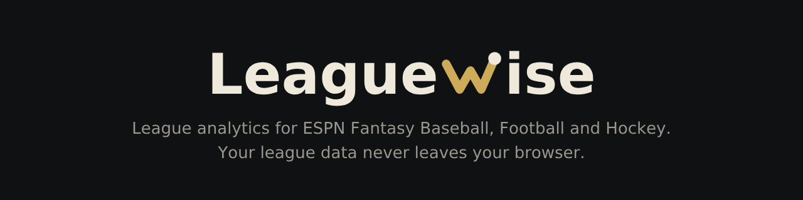
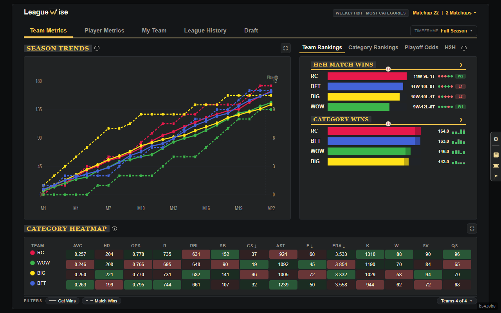
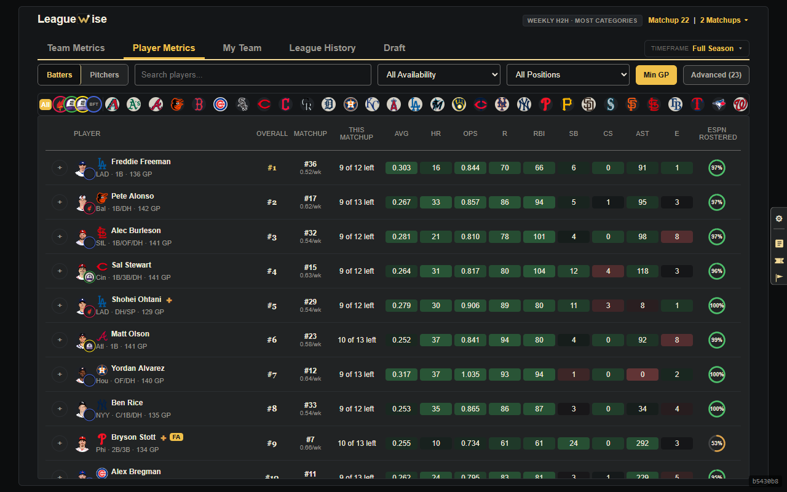
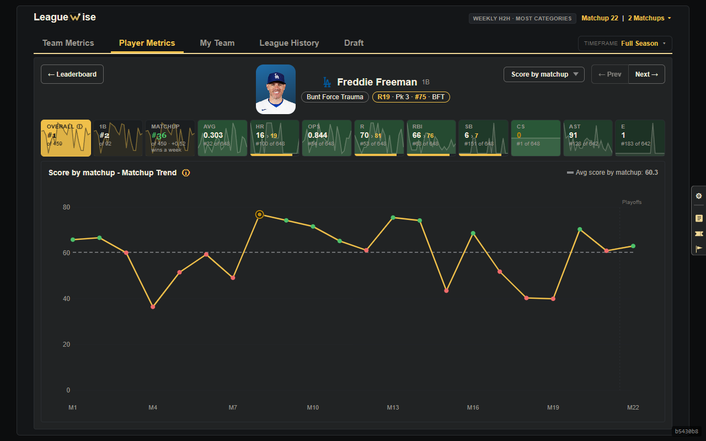
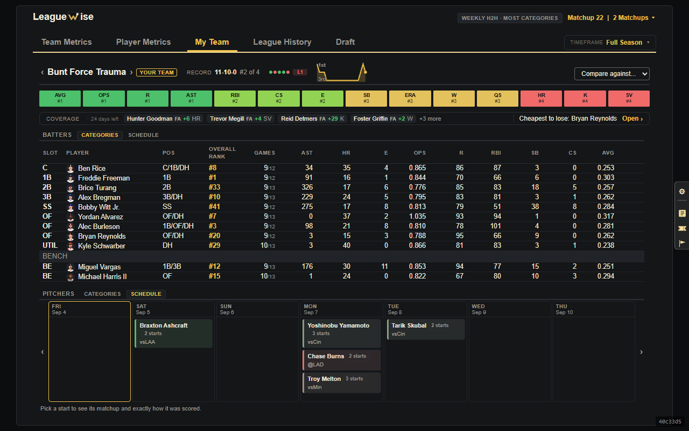
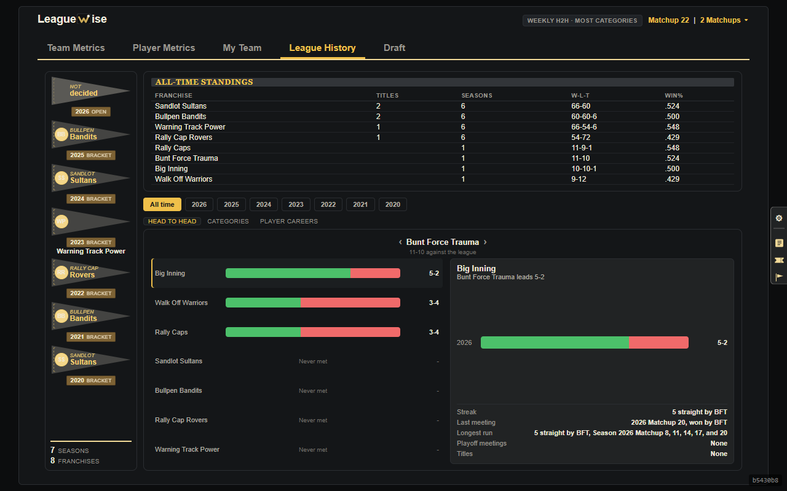

<p align="center"></p>

<p align="center">A browser extension for Firefox, Firefox for Android and Chrome.</p>

<p align="center">
  <a href="https://addons.mozilla.org/en-US/firefox/addon/leaguewise/"></a>
  <a href="https://chromewebstore.google.com/detail/leaguewise/emnepcdlpnnphjgfiajhkciijciifdoj"></a>
</p>


League analytics for ESPN Fantasy Baseball, Football and Hockey. Everything behind the standings: how every team got where it is, how every player rates in your league's own categories, and what your roster needs next, from the ESPN login already in your browser. Works with head-to-head categories, head-to-head points and season-long roto.

## Built with AI, reviewed by humans

AI is actively used for developing and maintaining this project. Humans review and test every change before it lands.

## Your data stays in your browser

- No backend, no servers. The extension runs entirely in your browser.
- Your data never leaves your browser. Your league info comes from ESPN's fantasy API, using login already in your browser. Player photos come from ESPN's image CDN.
- No analytics, telemetry, or tracking.
- Three permissions: `cookies` (your ESPN session), `storage` (your settings), `clipboardWrite` (the export button).
- No dependencies, no build step. The code in this repository is the code that runs.

## What it does

Each tab provides a different view into your league.

- **Team Metrics**: season trend lines for every team over the whole season or the last few matchups, category rankings, a category heatmap, a head-to-head series matrix, and playoff odds run on your league's own played weeks.

<p align="center"></p>

- **Player Metrics**: every player in your league ranked against your league's own categories and adjusted for playing time, with a player drill down showing the matchup-by-matchup trend and a comparison with any other player.

<p align="center"></p>

<p align="center"></p>

- **My Team**: your roster with each player's rank and category line, comparison against any opponent category by category. Includes a schedule view for all positions showing matchup difficulty, off nights and more.

<p align="center"></p>

- **Draft**: ranked projections, last season's standings and a post draft recap that tracks how your picks are faring.

- **League History**: every season your league has played, with all-time standings, a rivalry page for any opponent, and career totals for every player who has appeared.

<p align="center"></p>

One timeframe control drives Team Metrics, Player Metrics, and My Team. Pick a part of the season you want to see in more detail.

Two looks, Boxscore and Modern, each in light and dark, under Display in the settings.

- **Export and share**: CSV or clipboard export of any view, and a recap image for the league group chat.

## Install

**[Add to Firefox](https://addons.mozilla.org/en-US/firefox/addon/leaguewise/)** or **[Add to Chrome](https://chromewebstore.google.com/detail/leaguewise/emnepcdlpnnphjgfiajhkciijciifdoj)**.

Click the extension icon, enter your league's sport, ID, and year, and hit **Fetch Data**.

For development, load it temporarily instead: in Firefox, go to `about:debugging#/runtime/this-firefox`, click **Load Temporary Add-on**, and select `manifest.json` from a clone. Temporary add-ons are removed when Firefox restarts.

## Dev preview (no ESPN account needed)

`dev-preview.html` runs the full dashboard against a bundled anonymized sample league, with the WebExtension APIs stubbed:

```
python -m http.server 8123
```

Then open `http://localhost:8123/dev-preview.html`.

To use your own league's data: load the real extension, download a JSON dump from the Diagnostic Data panel, put it in a `JSON_debug/` folder at the repository root, and pick it with `?payload=<filename>`. That folder is gitignored. Don't commit it.

## Tests

In-browser unit tests, no test runner. Open them through the same server:

- `http://localhost:8123/tests/rank-engine.test.html`
- `http://localhost:8123/tests/features.test.html`

A green header means everything held.

## Stack

Vanilla ES modules, one CSS file, no framework, no build step, no dependencies.

## Releases

What changed in each release is in the [changelog](CHANGELOG.md).

## Work in progress

- **Microsoft Edge.** The Chrome package installs in Edge today; the Edge Add-ons listing follows this release.

## License

See `LICENSE` (Mozilla Public License 2.0).

See [DISCLAIMER.md](DISCLAIMER.md).

To check that a download is exactly this repository's tagged source, see [Verifying a release](SECURITY.md#verifying-a-release).

[](https://scorecard.dev/viewer/?uri=github.com/tylerpriice/leaguewise)
